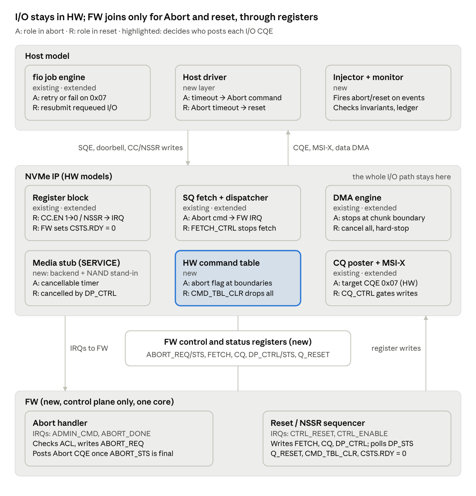
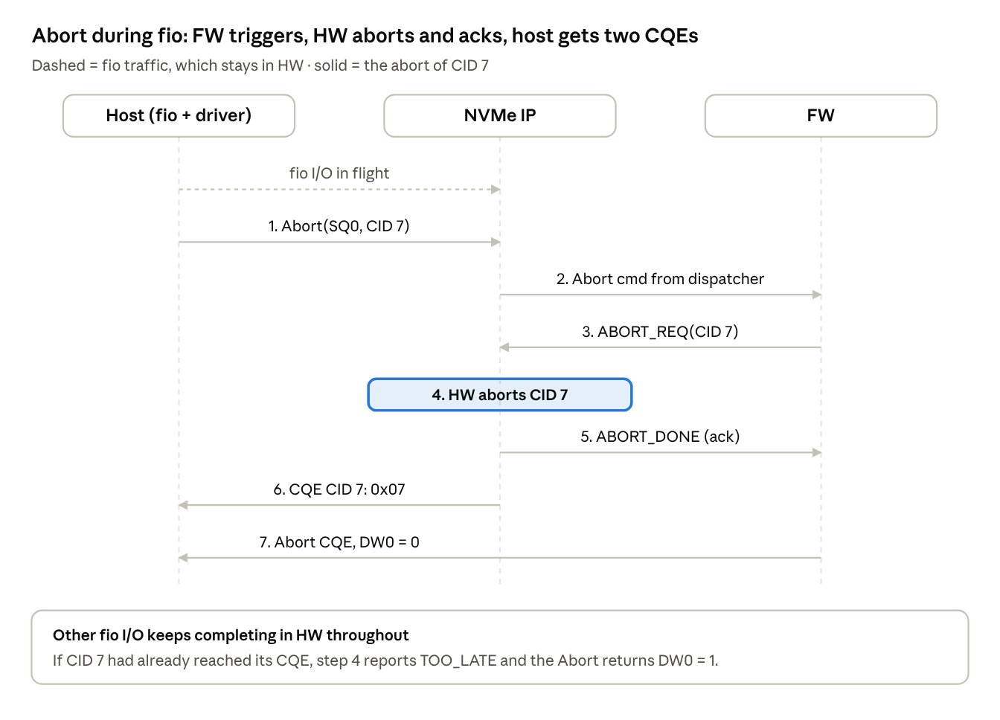
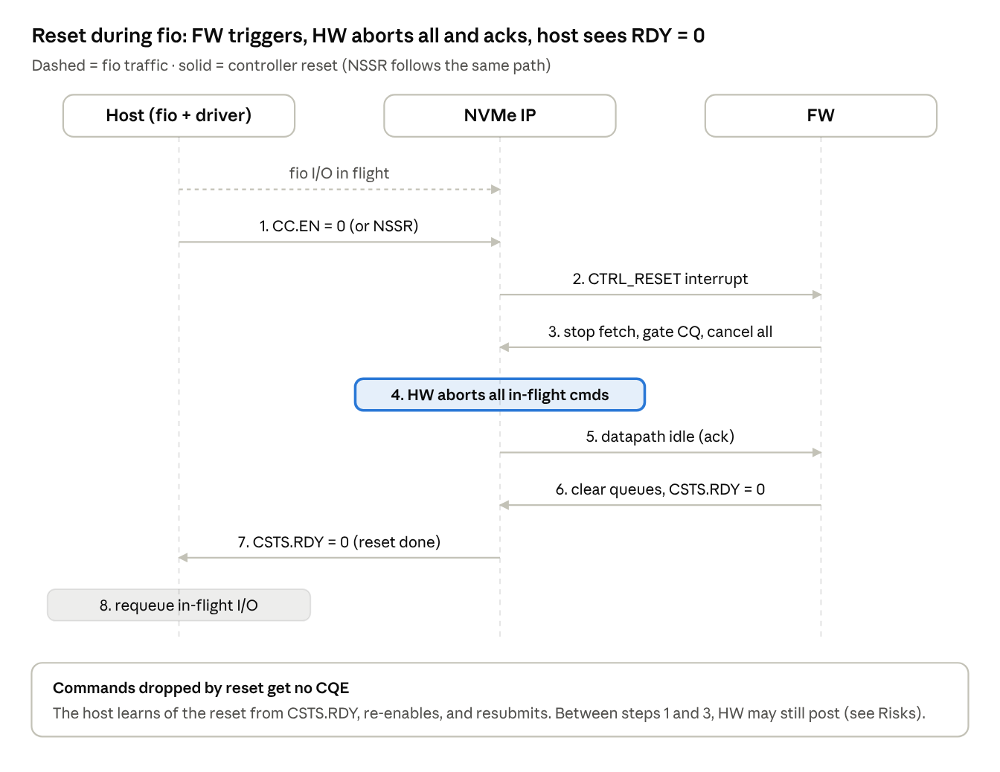

# Proposal: Abort and NVMe Reset Support in the SimPy Framework

Oct 20, 2026 · Kush

## Summary

- **Goal:** extend our SimPy performance framework to model NVMe **Abort** and **NVMe resets** (controller reset and NSSR) while fio traffic is running. Architecture changes in these flows can then be checked before RTL and FW exist.
- **Approach:**
  - Keep the I/O path in HW exactly as today.
  - Add a small control-plane FW that receives the Abort command and reset interrupts, and acts on HW through registers.
  - Add exception handling to the HW IPs and the host.
- **Outcome:** a repeatable test suite that proves no command is lost, duplicated or leaked under abort and reset, and that measures recovery time.
- **Impact on today's results:** none. FW is outside the I/O path, so current performance numbers stay valid.

## Scope

| In scope | Out of scope (later) |
| --- | --- |
| Abort command | Backend and NAND (replaced by a timing stub) |
| Controller reset (CC.EN) and NVM Subsystem Reset (NSSR) | PCIe resets (FLR, PERST#) and shutdown |
| All of the above injected during fio at full queue depth | Multiple controllers, multi-core FW |

## What changes

Three additions, marked *new* or *extended* in the diagram:

1. **FW control plane** (one core): an Abort handler and a reset sequencer.
2. **HW IPs:**
   - command table with an abort flag
   - cancellable data transfer and media stub
   - fetch stop and completion gate
   - FW control registers
3. **Host:** a driver with timeouts, Abort, reset escalation, retry, and completion-status handling.



## How abort works

The host's Abort goes to FW. FW tells HW which command to stop, HW stops it and confirms, and the host receives two completions: one for the aborted command and one for the Abort itself.



Only the aborted command changes course; all other fio I/O completes normally.

## How reset works

The reset reaches FW as an interrupt. FW tells HW to stop and cancel everything, HW confirms it is idle, and FW signals the host that the reset is done.



Commands dropped by the reset get no completion; the host resubmits them once the controller is re-enabled.

## What the model will prove

- No command is lost, duplicated or completed twice, under abort, reset, and both together.
- Nothing reaches host memory after the reset gate.
- No resource leaks after repeated resets.
- Reset finishes within the NVMe time limit (CAP.TO), even with a stuck data transfer.
- Success-path performance is unchanged.

This is checked by 16 targeted scenarios injected during fio, including an abort that escalates to a reset.

## Plan

1. Spec and register map
2. FW control plane in SimPy
3. HW IP exception paths
4. Host driver and completion-status handling
5. Test scenarios and automated checks
6. Regression against today's results, and review

**Checkpoint after step 4:** demonstrate basic abort and reset during fio, then make a go/no-go decision before the full scenario suite.

## Risks and decisions

| Item | Why it matters | Decision or ask |
| --- | --- | --- |
| Reset exposure window | Between the host's reset and FW's first register write, HW may still send completions to the host | Decide whether HW blocks completions on reset by itself (a HW change) or FW response time is enough. The model will quantify the window |
| Model timing accuracy | FW and register timings start as estimates | Access to FW profiling data to calibrate |
| Backend and NAND | High complexity: NAND operations cannot be cancelled, and the backend may add FW cores | Plan as a separate follow-on phase |

## Appendix: pseudocode

The pseudocode below is for readers who want the mechanics behind the abort and reset diagrams. Each block has a short table of what its functions do.

### Abort: NVMe IP (HW)

| Function | What it does |
| --- | --- |
| `dispatcher` | Existing dispatcher with one new branch: admin commands (the Abort) go to FW as an interrupt; I/O is recorded in the HW command table and continues down the HW path as today |
| `boundary` | Check run at every stage boundary. If the command's abort flag is set, it stops the command, posts its 0x07 completion and reports ABORTED to FW |
| `on_abort_req` | HW reaction to FW writing ABORT_REQ. Reports NOT_FOUND or TOO_LATE, or sets the abort flag; stops the command at once if it is queued or in the media stub, or at the next chunk if it is mid-transfer |
| `dma_job` | Existing data transfer, made cancellable: checks the abort flag and cancel-all before each chunk, and can be force-stopped |
| `cq_post` | The only place an I/O completion is written. Claims each command once (so no double completion) and drops the write if FW has gated completions |
| `report` | Writes the abort outcome to ABORT_STS and raises ABORT_DONE to FW |

```python
# HW command table (new): (sqid, cid) -> state, abort_pending

def dispatcher(cmd):                       # existing IP, one new branch
    if cmd.sqid == 0:                      # admin (Abort) -> FW
        return fw.irq("ADMIN_CMD", cmd)
    tbl.add(cmd.key, DISPATCHED)           # I/O stays in HW, as today
    io_pipe.put(cmd)

def boundary(t):                           # called by every HW stage
    if t.abort_pending:
        cq_post(t, ABORT_REQUESTED)        # target CQE 0x07 from HW
        report(t.key, "ABORTED")
        return False                       # stage stops this command
    return True

def on_abort_req(key):                     # FW wrote ABORT_REQ
    t = tbl.get(key)
    if t is None: return report(key, "NOT_FOUND")
    if t.state in (CQE_PENDING, DONE): return report(key, "TOO_LATE")
    t.abort_pending = True
    if t.state == DISPATCHED: io_pipe.remove(t); boundary(t)
    elif t.state == SERVICE: t.stub.interrupt(); boundary(t)
    # DMA_ACTIVE: stays PENDING until the next chunk boundary

def dma_job(t):                            # existing transfer, now cancellable
    t.state = DMA_ACTIVE
    for chunk in t.chunks:
        if not boundary(t) or DP_CTRL.cancel_all: return
        yield env.timeout(chunk_time(chunk)) | hard_stop_evt
        if hard_stop_evt.triggered: return
    next_stage(t)                          # boundary() runs again there

def cq_post(t, status):                    # the only writer of I/O CQEs
    if not tbl.claim(t): return            # atomic -> CQE_PENDING, once
    if CQ_CTRL.gate: return                # FW gated it (reset)
    cq[t.sqid].write(t.cid, status, phase); msix.maybe_fire()

def report(key, result):
    ABORT_STS = (key, result); fw.irq("ABORT_DONE")
```

### Abort: FW

| Function | What it does |
| --- | --- |
| `on_admin_cmd` | Runs when the dispatcher hands FW an Abort. Rejects it with 0x03 if too many Aborts are already outstanding (ACL); otherwise records it and writes ABORT_REQ to HW. It does not wait for the result |
| `on_abort_done` | Runs when HW raises ABORT_DONE. Reads the outcome and posts the Abort's own completion: DW0 = 0 if aborted, 1 if not. Does nothing if a reset has already taken over |

```python
def on_admin_cmd(cmd):                     # IRQ from the dispatcher
    yield from core.run(cyc.admin)
    if fw_state != READY or cmd.opc != ABORT: return
    if aborts_out >= ACL + 1:
        return admin_cqe(cmd, ABORT_LIMIT_EXCEEDED)
    aborts_out += 1; pending[cmd.target] = cmd
    yield from reg_write(ABORT_REQ, cmd.target)  # costs register latency

def on_abort_done():                       # IRQ from HW
    key, result = yield from reg_read(ABORT_STS)
    cmd = pending.pop(key, None)
    if cmd is None or fw_state != READY: return
    aborts_out -= 1
    admin_cqe(cmd, OK, dw0=0 if result == "ABORTED" else 1)
```

### Reset: NVMe IP (HW)

| Function | What it does |
| --- | --- |
| `on_host_reg_write` | Register block reaction to the host. CC.EN 1→0 or an NSSR write raises CTRL_RESET to FW; CC.EN 0→1 raises CTRL_ENABLE. Optionally gates completions immediately (the HW auto-gate option under evaluation) |
| `on_fw_reg_write` | HW reaction to FW's control registers: stop fetch, gate completions, stop new work, cancel all in-flight transfers and media-stub work, force-stop a stalled transfer, reset queues, clear the command table |
| `dp_sts` | Datapath status that FW polls: how many transfers, media-stub operations and commands are still outstanding |

```python
def on_host_reg_write(reg, val):           # register block
    if reg == CC and CC.EN == 1 and val.EN == 0:
        CC.EN = 0; fw.irq("CTRL_RESET", kind="CC_EN")
        if HW_AUTO_GATE: CQ_CTRL.gate = 1  # design option under study (C15)
    elif reg == NSSR and val == 0x4E564D65 and CAP.NSSRS:
        fw.irq("CTRL_RESET", kind="NSSR")
    elif reg == CC and CC.EN == 0 and val.EN == 1:
        CC.EN = 1; fw.irq("CTRL_ENABLE")

def on_fw_reg_write(reg, val):             # FW control registers
    if reg == FETCH_CTRL: fetch_enable = not val.stop
    elif reg == CQ_CTRL:  cq_gate = val.gate
    elif reg == DP_CTRL:
        dispatcher.accept = not val.stop_new
        if val.cancel_all:
            for t in stub_active: t.stub.interrupt()
            for j in dma_active: j.cancel_req = True
        if val.hard_stop: hard_stop_evt.succeed()
    elif reg == Q_RESET: reset_io_queues(); reset_admin_ptrs()
    elif reg == CMD_TBL_CLR: tbl.clear(); free_tags_and_buffers()

def dp_sts():                              # read by FW, or QUIESCED IRQ
    return Sts(dma_busy=len(dma_active), stub_busy=len(stub_active),
               outstanding=len(tbl))
```

### Reset: FW

| Function | What it does |
| --- | --- |
| `on_ctrl_reset` | The reset sequence, run at highest priority. In order: stop fetch, gate completions, cancel all work, poll until idle (force-stop after a timeout), reset queues and command state, drop pending Aborts, apply NSSR effects if needed, then set CSTS.RDY = 0 |
| `on_ctrl_enable` | Runs when the host re-enables the controller: reloads the admin queue, lifts the datapath, completion and fetch controls, and sets CSTS.RDY = 1 |

```python
def on_ctrl_reset(kind):                   # IRQ; highest priority
    fw_state = RESETTING                   # pending Aborts will get no CQE
    yield from reg_write(FETCH_CTRL, stop=1)                 # 1. no new commands
    yield from reg_write(CQ_CTRL, gate=1)                    # 2. nothing to host
    yield from reg_write(DP_CTRL, stop_new=1, cancel_all=1)  # 3. cancel work
    t0 = env.now
    while (yield from reg_read(DP_STS)).busy:                # 4. wait for idle
        if env.now - t0 > T_QUIESCE:
            yield from reg_write(DP_CTRL, hard_stop=1); break
        yield env.timeout(POLL)
    yield from reg_write(Q_RESET, io=1, admin=1)             # 5. queues
    yield from reg_write(CMD_TBL_CLR, 1)                     #    and state
    pending.clear(); aborts_out = 0
    if kind == "NSSR": regs.to_defaults(); CSTS.NSSRO = 1
    yield from reg_write(CSTS, RDY=0)                        # 6. done
    fw_state = DISABLED

def on_ctrl_enable():
    yield from core.run(cyc.init)
    hw.load_admin_queue(AQA, ASQ, ACQ)
    yield from reg_write(DP_CTRL, 0)
    yield from reg_write(CQ_CTRL, gate=0)
    yield from reg_write(FETCH_CTRL, stop=0)
    yield from reg_write(CSTS, RDY=1); fw_state = READY
```
